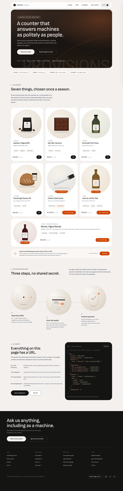

# Fitzwilliam Provisions

A storefront built as a **test counter for agentic checkout**: a real landing page with a
working basket, an age gate that the server enforces, and a machine surface an agent can walk
without scraping HTML.

Styled end to end from `~/Development/getdesignmd/DESIGN-mastercard.md` — warm cream canvas,
40px stadium frames, circular product portraits with satellite CTAs, ink-only marketing CTAs,
and Signal Orange spent exclusively on consent and age-restricted goods.



## Run it

```bash
python3 server.py                 # http://127.0.0.1:8088
python3 mcp_server.py             # http://127.0.0.1:8090/mcp
python3 server.py --port 9000     # or pick a port
```

Standard library only, no build step, no network calls at runtime. Sofia Sans is self-hosted
(`assets/fonts/`), all imagery is local SVG.

## What is on the shelf

| # | Product | Category | Price | Restriction |
|---|---------|----------|-------|-------------|
| 1 | Gasharu Yirgacheffe | pantry | €18.50 | — |
| 2 | Sea Salt, Seventy | pantry | €6.90 | — |
| 3 | Koroneiki First Press | pantry | €22.00 | — |
| 4 | Sourdough Starter Kit | kitchen | €32.00 | — |
| 5 | Carbon Steel Gyuto | kitchen | €129.00 | `bladed_article_18` |
| 6 | Loam & Lilt Pét-Nat 2023 | wine | €28.00 | `alcohol_18` |
| 7 | Barolo, Vigna Rionda 2019 | wine | €46.00 | `alcohol_18` |

`products.json` is the single source of truth. The server serves it, injects it as JSON-LD into
the page, and `verify.py` cross-checks the rendered cards against it (price, id, restriction).

## Deploying it (static hosting)

`server.py` only runs on a machine where Python is executing. Uploaded to shared hosting it is
just a file: `/api/checkout` then answers with the host's 404 HTML page, `res.json()` fails, and
the basket reports `non-JSON response`. Same for `/catalog.json`, `/.well-known/ucp` and
`/llms.txt`, which exist only as server routes.

For a host that runs PHP but not Python (Hostinger, cPanel, most shared plans):

```bash
python3 build_static.py --base-url https://store.leobo.me   # → dist/ + nothing else
```

That bundle carries `index.html` (JSON-LD injected, `fv-api` meta pointed at the PHP route),
`catalog.json`, `llms.txt`, `ucp-profile.json`, `.well-known/ucp` (forced to `application/json`
by `.htaccess`), `api/checkout.php`, `api/quote.php`, `api/ping.php`, `products.json` and
`assets/`. Upload the **contents** of `dist/` to the web root.

Then verify in this order:

1. `GET /api/ping.php` — JSON means PHP is executing and the catalog is readable.
   HTML/404 means the plan has no PHP and the API has to live somewhere else.
2. `POST /api/checkout.php` — expect `200` with a session, `422` for a wine-only basket.
3. Load `/` and check out.

`api/checkout.php` is a line-for-line twin of `price_basket()` in `server.py` (same codes, same
VAT arithmetic, same age gate), so both deployments behave identically. `assets/app.js` reads
the `fv-api` meta tag and only falls back to trying `/api/checkout` then `/api/checkout.php`
when that tag is missing, which is why a static host no longer produces a console 404.

Two things a shared host cannot do, and the bundle does not pretend otherwise: the 402 quote
publishes the wire shape but settlement is unimplemented, and the age assertion is
self-declared. Also delete `server.py`, `mcp_server.py`, `verify.py`, `build_static.py` and
`tests/` from any web root you upload by hand — they are readable source, not sites.

## Machine surface

| Method | Path | What it returns |
|--------|------|-----------------|
| GET | `/.well-known/ucp` | UCP business profile: version, capabilities, handlers. `Cache-Control: public, max-age=3600`. Static bundle adds `ucp-profile.json` as a fallback path. |
| GET | `/catalog.json` | Products with prices in minor units, stock, restriction codes, VAT rate. |
| GET | `/llms.txt` | Plain-text map: endpoints, policy, product list. |
| POST | `/api/checkout` | Prices a basket. `200` with a session, or `422 age_verification_required`. |
| GET | `/api/agent/quote` | `402 Payment Required` with an x402 v2 `accepts[]` array (wire shape only). |

```bash
# unrestricted basket prices cleanly
curl -s localhost:8088/api/checkout -H 'content-type: application/json' \
  -d '{"items":[{"id":"cof-yir-250","quantity":2}],"age_verified":false}' | jq .

# a wine basket is refused until age is asserted
curl -s -o /dev/null -w '%{http_code}\n' localhost:8088/api/checkout \
  -H 'content-type: application/json' \
  -d '{"items":[{"id":"win-pet-2023","quantity":1}],"age_verified":false}'   # → 422

# x402 v2 shape, body and PAYMENT-REQUIRED header
curl -si localhost:8088/api/agent/quote | head -20
```

The 422 body is deliberately actionable for an agent: `error.code`,
`error.retryable`, `error.recovery: "verify_age"`, and the blocked lines with their
restriction codes. That is the piece worth testing against a real agent runtime.

## MCP server

`mcp_server.py` exposes the same shelf over the Model Context Protocol
(Streamable HTTP, JSON-RPC 2.0). By default it reuses `products.json` and
`price_basket()` from `server.py`, so offline discovery, VAT arithmetic and the
18+ gate cannot drift from the storefront. It is a separate process because a
static bundle cannot run Python. For a live catalog, it can read Supabase
instead; see below.

```bash
python3 mcp_server.py                    # http://127.0.0.1:8090/mcp
python3 mcp_server.py --host 0.0.0.0     # Android emulator reaches 10.0.2.2:8090
python3 mcp_server.py --store-url https://store.leobo.me
```

The same settings can come from the environment, which is what hosted
platforms use:

```bash
HOST=0.0.0.0 PORT=10000 STORE_URL=https://store.leobo.me python3 mcp_server.py
```

Command-line flags win over the environment. `PORT` is what Render and Cloud
Run inject automatically.

| Tool | What it does |
|------|--------------|
| `get_shop_profile` | Merchant, currency, age policy, categories, machine endpoints. |
| `list_products` | The shelf, filtered by category / stock / maximum price. |
| `search_products` | Free-text discovery across names, notes, SKUs and shopper aliases. |
| `get_product` | One product by id or SKU. |
| `price_basket` | Re-prices a basket and enforces the 18+ gate, returning a checkout session or an actionable `age_verification_required` error. |

Resources: `shop://catalog`, `shop://profile`, `shop://policy/age`,
`shop://llms.txt`, and the template `shop://products/{productId}`.

```bash
curl -s localhost:8090/health | jq .
curl -s localhost:8090/mcp -H 'content-type: application/json' \
  -d '{"jsonrpc":"2.0","id":1,"method":"tools/list"}' | jq .
python3 tests/test_mcp.py          # starts its own server on :8099
```

The server is stateless (no `Mcp-Session-Id`), answers POSTs with JSON rather
than a server-initiated SSE stream, and returns `405` for `GET /mcp`. It binds
loopback by default; `--host 0.0.0.0` is for the Android emulator and exposes an
unauthenticated test shelf, so keep it on a trusted network.

Product links and images are pointed at the storefront. By default the base is
derived from the request host plus `:8088` (so an emulator calling
`10.0.2.2:8090` gets images from `10.0.2.2:8088`); pass `--store-url` behind a
proxy or when the storefront moves.

The Helping Bee app uses MCP for shop discovery: `list_products` for the initial
shelf and `search_products` for free-text questions the local assistant does not
recognise. In the app, open **Settings → Shop → Shop connections** to set the
storefront, MCP and Stripe test backend URLs at runtime, test each service, or
restore the build defaults. The MCP field adds `/mcp` when you enter only a
host; the storefront field rewrites product image and link origins to an
address the device can reach while keeping their paths and fragments. Saved
values persist across app launches and take precedence over the build-time
defaults.

### Supabase catalog (live products)

`products.json` remains the offline fallback, but the POC can use Supabase as
the live source of truth. The MCP process refreshes from Supabase on a short
cache, so adding a row in the dashboard does not require redeploying the app or
the MCP service.

1. Create a free Supabase project.
2. In the SQL editor, run `supabase/setup.sql` (or run `schema.sql` and
   `seed.sql` separately).
3. Create a public Storage bucket named `product-images` for new imagery, and
   put its public URLs in `products.image_url`.
4. Set these environment variables wherever the MCP server runs:

   ```text
   SUPABASE_URL=https://<project>.supabase.co
   SUPABASE_ANON_KEY=<anon public key>
   SUPABASE_PRODUCTS_TABLE=products
   CATALOG_CACHE_SECONDS=5
   ```

   The anon key is read-only through the RLS policy in `schema.sql`. Do not put
   the service-role key in the Android app.

5. Start the server normally:

   ```bash
   SUPABASE_URL=... SUPABASE_ANON_KEY=... python3 mcp_server.py
   ```

The server prints the active catalog source and falls back to the last good
shelf if Supabase is temporarily unreachable. `GET /health` reports
`catalogSource` and `catalogError`.

To add a product during a demo, insert a row in the Supabase **Table Editor**
with an id, SKU, name, category, `price_minor`, stock, image URL and optional
`age_restriction` / `search_tags`. After the cache TTL, the app sees it on the
next shelf reload—no APK build and no MCP redeploy.

### Deploy the MCP server to Render

The repository includes `render.yaml` for a free Render web service. Push this
directory to GitHub, GitLab or Bitbucket, then in Render choose **New →
Blueprint** and select the repository. Render reads the blueprint and creates
the service with:

- Build command: `pip install -r requirements.txt`
- Start command: `python3 mcp_server.py`
- Health check: `/health`
- Environment: `HOST=0.0.0.0`, `STORE_URL=https://store.leobo.me`
- Optional live catalog: `SUPABASE_URL`, `SUPABASE_ANON_KEY`,
  `SUPABASE_PRODUCTS_TABLE=products`, `CATALOG_CACHE_SECONDS=5`
- Python: `3.12.6`

Change `STORE_URL` in `render.yaml` if the storefront lives somewhere else.
After the deploy finishes, the endpoint is:

```text
https://<service-name>.onrender.com/mcp
```

The current deployment is:

```text
https://fitzwilliam-provisions-mcp.onrender.com/mcp
```

Put that in the app under **Settings → Shop → Shop connections → MCP server
URL**, then use **Test**.

Render's free web services sleep after 15 minutes without traffic and take
about a minute to wake, so the first Shop request after idle can be slow. The
service is stateless and needs no database or persistent disk.

The Helping Bee build defaults already point at the deployed MCP endpoint above
and at `https://store.leobo.me`. Gradle properties can still override those
initial values, which is useful for CI or a preconfigured APK:

```bash
# Default: Render MCP + https://store.leobo.me
./gradlew :app:assembleDebug

./gradlew :app:assembleDebug \
  -PSHOP_MCP_URL=http://host:8090/mcp \
  -PSHOP_STOREFRONT_URL=http://host:8088 \
  -PSTRIPE_BACKEND_URL=http://host:4242
```

The app's built-in defaults point at the hosted MCP, the production storefront
and the Render Stripe test backend. There are no local service defaults left;
the Gradle properties above are only for overrides.

## Age gate: three layers, one of them honest

1. **UI** — restricted cards show a Signal Orange consent pill instead of "Add". Clicking it opens
   the age dialog; the item is queued and only lands in the basket after confirmation.
2. **Client state** — `age_verified` is sent on the checkout request and persists in
   `localStorage` (`fv.age.v1`).
3. **Server** — `POST /api/checkout` re-checks the restriction codes on the priced lines and
   returns `422` regardless of what the UI did. Bypassing the button does not bypass the gate.

What it is **not**: verification. The assertion is self-declared (`age_assertion.method:
"self_declared"`), and a real shop needs an age-verification provider, ID capture at delivery,
and an audit trail. The response says so in a `note`, so a demo never gets mistaken for compliance.

## Design system mapping

Tokens live in `assets/styles.css`, each annotated with the spec section it came from.

| Spec | Implementation |
|---|---|
| Canvas Cream `#F3F0EE`, never white | `--canvas`, body background |
| Ink Black `#141413` | `--ink`, primary pills, footer, code block |
| Signal Orange `#CF4500` — consent/legal only | `--signal`: age chips, consent pills, age strip, error surface |
| Light Signal Orange `#F37338` — decorative arcs | `--arc`: hero and orbit arcs, eyebrow dots, satellite accents |
| 40px stadium / 20px buttons / 999px pills / 50% circles | `--r-stadium`, `--r-btn`, `--r-pill`, circular `.card__media` |
| Floating white nav pill, 24px from top | `.nav-shell` / `.nav`, `backdrop-filter`, `0 4px 24px rgba(0,0,0,.04)` |
| Ghost watermark, cream-on-cream | hero `PROVISIONS` at 7.5% cream on the ink ground |
| Orbit portraits + satellite CTA + arcs | `.orbit`, `.satellite`, `.orbit-arc` |
| Ink footer, 4 columns, tall bottom padding | `.footer`, 148px bottom |
| Weight 450 body / 500 headlines, −2% tracking | `body`, `h1–h4` |
| Sofia Sans substitute, self-hosted | two woff2 subsets, `latin` + `latin-ext` |

### Deliberate deviations

- **No dark mode.** The spec is a light, warm editorial system and ships no inverse tokens;
  inverting it would be a redesign rather than an application of the system. Cream is the
  default here by design, not by oversight. Say the word and I will derive a dark variant with
  the ink surfaces lifted one step and the arc colours kept.
- **Consent pill vertical padding** raised from the spec's `1px 30px` to `11px 30px`: the spec's
  own §5 touch-target rule (≥44px) wins over its literal padding value.
- **Muted text tokens** moved one step darker (`#4B5563`, `#6B7280`) for WCAG AA on cream.
  Small orange labels use `#9A3A00` (6.36:1 on the tint) while every orange *fill* stays `#CF4500`.
- **Product images are SVG, not photography**, and load eagerly: seven files total ~10KB, so
  `loading="lazy"` bought nothing and produced blank circles on slow first paint.
- **The 7th product is a full-width feature card.** Seven items in a three-column grid leaves an
  orphan row; the wide card closes the shelf and gives the Barolo the room it deserves.

## Tests

```bash
python3 server.py &
python3 verify.py                 # static tokens + served routes, 55 checks
python3 tests/e2e.py              # Playwright: 22 checks against the real UI + screenshots

# the PHP bundle, against a container that mimics the shared host
python3 build_static.py
docker run -d --name fv-php -p 127.0.0.1:8090:8090 \
  -v "$PWD/dist":/app -w /app php:8.3-cli php -S 0.0.0.0:8090 -t /app
FV_BASE=http://127.0.0.1:8090/ python3 tests/e2e.py
docker rm -f fv-php
```

`FV_BASE` points the same 22 browser checks at either backend. Both are green today.

`verify.py` checks card data against `products.json`, token presence, brace/tag balance, no
external asset references, that Signal Orange is not spent on marketing fills, the 422 path, the
402 header, and JSON-LD injection.

`tests/e2e.py` needs Playwright (`uv pip install --python /home/leonard/.venv/bin/python playwright`,
Chromium is already cached). It asserts the rendered canvas colour, the 40px and 50% radii, that
adding wine opens the gate and *does not* add the item, that confirmation adds it, that the
basket totals €92.50 with €13.84 VAT, that checkout returns 200 with a session, that an
unverified basket returns 422, and that nothing overflows at 390px. Screenshots land in
`/tmp/fvshots/`.

## Files

```
index.html            markup, JSON-LD placeholder
assets/styles.css     tokens + components, spec-cited
assets/app.js         basket, age gate, checkout, agent payload
assets/img/*.svg      seven product illustrations + palette
assets/fonts/         Sofia Sans latin / latin-ext woff2
products.json         single source of truth
server.py             static server + UCP profile, catalog, checkout, 402 quote
verify.py             static + served verification
tests/e2e.py          Playwright end-to-end
docs/*.png            rendered screenshots
```

## Where to take it next

- Wire a real **UCP capability negotiation** (send `UCP-Agent`, intersect capabilities) instead
  of serving a static profile.
- Replace the 402 stub with a **facilitator** call: verify `PAYMENT-SIGNATURE`, settle, return
  `PAYMENT-RESPONSE`. Today the endpoint only publishes the shape and says so.
- Add **AP2 mandate** fields to the checkout body so a purchase can carry a signed proof of
  human intent, which is the natural companion to the age assertion this build already models.
- Make the age assertion a **verifiable credential** rather than a boolean, so the agent can
  present a proof without the shop holding a date of birth.
